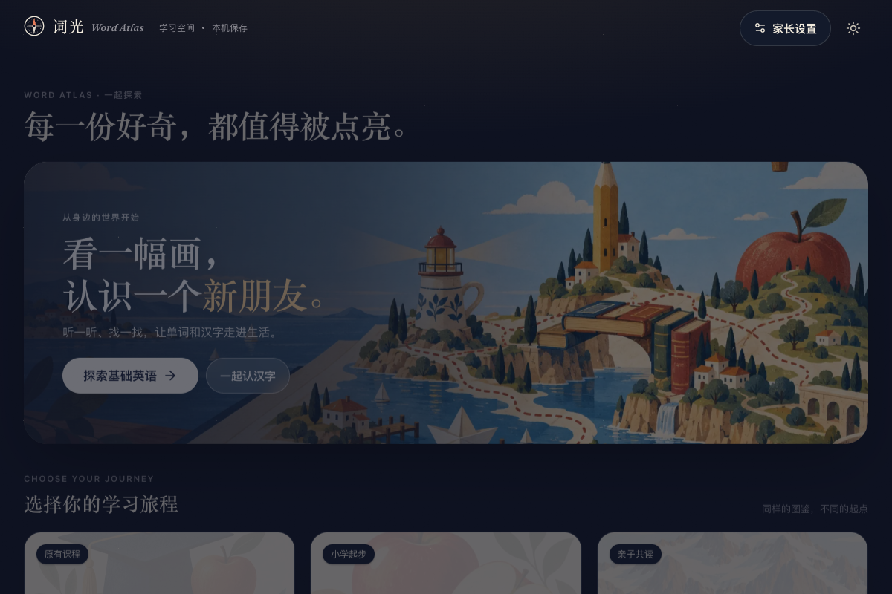
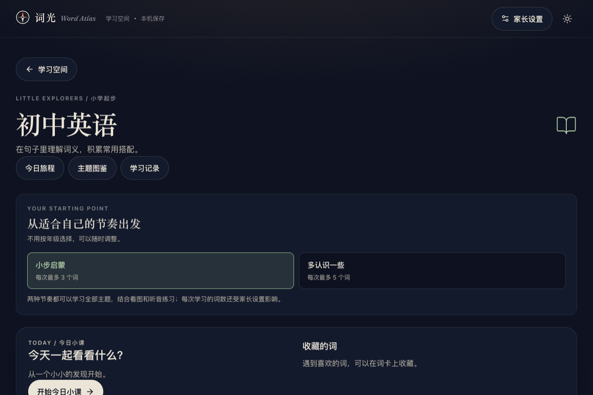
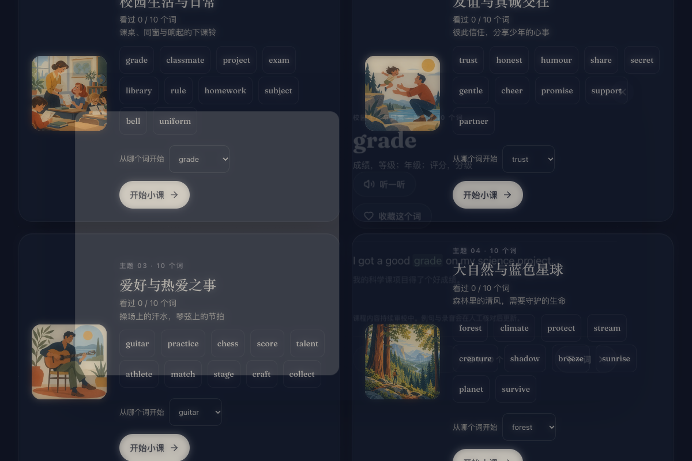
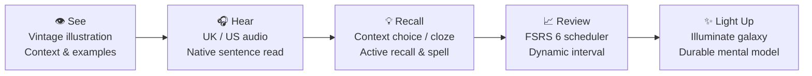

<div align="center">

<a href="https://github.com/gmnoah/word-atlas"></a>

# Word Atlas · 词光

**See the word. Hear it. Make it yours.**

7,298 IELTS words · 1,100 Junior High words · 300 Primary words · 300 Hanzi characters  
Original paper-feel illustrations · UK & US audio · FSRS spaced repetition · 3D Galaxy · Local-first

[**Try Word Atlas ↗**](https://0xlei.tech/words/)　·　[**48-second film**](docs/assets/launch.mp4)　·　[**Get the dataset**](data/)　·　[**简体中文**](README.md)

[](https://github.com/gmnoah/word-atlas)
[](LICENSE)
[](CONTENT_LICENSE.md)
[](package.json)
[](tsconfig.json)
[](#local-first--multi-learner)

</div>

---

**Word Atlas (词光)** is an illustrated, auditory, and context-driven vocabulary learning platform for learners of all ages.

Moving beyond rote memorization, Word Atlas pairs every entry with an original vintage-style illustration, authentic audio pronunciations, contextual examples, and the modern **FSRS 6** spaced repetition scheduler. **Pure client-side single page app (SPA) — no account required, zero tracking, zero ads. All progress and retention data stay securely on your device.**

> **Version scope:** This repository contains the full open-source code and open multimedia dataset of Word Atlas. The hosted demo evolves separately and may have different features. The code and dataset remain available under their respective **MIT** and **CC BY 4.0** licenses.

[Preview](#preview) · [Learning Spaces](#four-learning-spaces) · [Learning Loop](#learning-loop) · [Local-First & Multi-Learner](#local-first--multi-learner) · [Quick Start](#quick-start) · [Open Dataset](#open-dataset) · [License & Credits](#license--credits)

---

## Preview

### A vocabulary atlas you can listen to and practise with


<table>
<tr>
<td width="50%"></td>
<td width="50%"></td>
</tr>
<tr><td align="center"><b>Daily Study Plan</b>: Focus on today, learn steadily</td><td align="center"><b>Word Card</b>: Illustration, meaning, and audio together</td></tr>
</table>

### Junior High Curriculum: 110 Contextual Units

<table>
<tr>
<td width="33%"></td>
<td width="33%"></td>
<td width="33%"></td>
</tr>
<tr>
<td align="center"><b>Dedicated Space Card</b><br>Pacing panel for self-study</td>
<td align="center"><b>Grade Navigation</b><br>Grade 7, 8 & 9 (110 units)</td>
<td align="center"><b>Contextual Question</b><br>Target in context, collocations</td>
</tr>
</table>

### Watch your vocabulary take shape in a 3D Galaxy


Explore topics as an interactive celestial constellation. Pan, rotate, zoom, and click stars to open word cards. Brightness reflects your mastery. Built with WebGL2, with graceful fallback to an organized topic list on unsupported hardware.

<details>
<summary><b>🎬 Watch the 48-second introduction</b></summary>

<a href="docs/assets/launch.mp4"></a>

[▶ Play full video with original soundtrack](docs/assets/launch.mp4)

</details>

---

## Four Learning Spaces

Word Atlas expands into a multi-space curriculum serving learners across stages:

| Learning Space | Scope | Focus & Curriculum Design | Core Activities |
| :--- | :--- | :--- | :--- |
| **🏛 IELTS Atlas** | **7,298 words**<br>CEFR A1–C2<br>19 topics | Designed for academic preparation and advanced vocabulary. Each word features an illustration, two original examples, UK/US audio, and usage notes. | Meaning selection · Image cloze<br>Listening recognition · Spelling<br>3D Galaxy |
| **🎒 Junior High** | **1,100 words**<br>110 units<br>Grades 7–9 | Built on the national curriculum standards. Covers health, sports, character, logic, science, and nature. Dual pacing options (5 or 10 words per session). | Contextual meaning choice (highlighted sentence)<br>Collocation reinforcement<br>Explanatory feedback |
| **🌱 Primary Starter** | **300 words**<br>33 units<br>Elementary | Low-stimulation interface with large buttons for young children. Everyday items, animals, food, and family life. | Audio-picture matching · Picture listening<br>Phonics cues · Family repeat |
| **🀄 Hanzi Starter** | **300 characters**<br>32 units<br>Preschool / Family | Designed for parent-child shared reading. Explores character origins through real-life scenarios without forced tests or rote drills. | Image-character matching · Character hunt<br>Scene exploration · Guided reading |

---

## Learning Loop



1. **See (Visual Perception)**: Connect words with illustrative scenes, defined parts of speech, and natural examples.
2. **Hear (Auditory Association)**: Switch freely between British (UK) and American (US) pronunciation, with native sentence recordings.
3. **Recall (Active Retrieval)**: Strengthen retrieval pathways through contextual choices, picture cloze, listening checks, and spelling.
4. **Review (FSRS 6)**: Powered by `ts-fsrs`, calculating optimal review intervals based on difficulty, stability, and first-attempt accuracy.
5. **Keep (Progress & Galaxy)**: Track your journey as a shining star constellation, with separate typing statistics.

---

## Local-First & Multi-Learner

Word Atlas is committed to a **no-login, privacy-respecting, local-first** architecture:

- **Zero Tracking**: No user tracking, no third-party telemetry, no advertisements.
- **Family Multi-Learner Profiles**: Switch between different family members or students on the same device. Progress, bookmarks, and sessions remain strictly isolated.
- **Offline Capable**: Cached resources and Service Worker support let you study without an active internet connection.
- **Full Backup & Safe Reset**: Export all learner progress into a verifiable JSON backup. Restore anytime with zero data loss, or reset a single course safely.

---

## Quick Start

### Prerequisites
- **Node.js 20+** and **npm**

### Development
```bash
# 1. Clone the repository (shallow clone recommended due to media assets)
git clone --depth 1 https://github.com/gmnoah/word-atlas.git
cd word-atlas

# 2. Install dependencies
npm install

# 3. Start development server
npm run dev
```

Open **`http://localhost:5188`** in your browser.

### Verification Commands
```bash
npm test                # Run unit and integration tests (260+ tests)
npm run check:atlas     # Validate IELTS dataset integrity & media existence
npm run check:courses   # Validate multi-course contracts (1,700 entries)
npm run build           # Compile TypeScript and build production bundle
npm run preview         # Preview production build locally
```

### Static Deployment
The output in `dist/` is a pure static single-page app ready for GitHub Pages, Cloudflare Pages, Vercel, Netlify, or Nginx.

For subpath hosting (e.g. `https://your-domain.com/words/`):
```bash
ATLAS_BASE=/words/ npm run build
```
See [deployment guide](docs/deployment.md) for details.

---

## Open Dataset

Word Atlas provides its structured dataset for research, app development, or Anki flashcards under CC BY 4.0:

| Resource | Scope | Access / File Path |
| :--- | :--- | :--- |
| **IELTS Vocabulary** | **7,298** entries, CEFR A1–C2, 19 topics | [JSON](data/word-atlas.json) · [CSV](data/word-atlas.csv) |
| **Bilingual Examples** | **14,596** daily & academic examples | [Schema Documentation](docs/dataset.md) |
| **Illustrations** | **7,298** WebP illustrations (512px) | [`public/atlas/img/`](public/atlas/img/) |
| **Audio Recordings** | **22,905** UK/US audio clips and example sentences | [`public/atlas/audio/`](public/atlas/audio/) |
| **Expanded Courses** | **1,700** multi-stage entries & contextual questions | [`src/courses/`](src/courses/) |

```python
import json
from pathlib import Path

words = json.loads(Path("data/word-atlas.json").read_text(encoding="utf-8"))
b2_env = [w for w in words if w.get("cefr") == "B2" and w.get("topic") == "environment"]
print(f"Found {len(b2_env)} B2 environment words")
```

---

## Contributing

Feedback, corrections, and improvements are always welcome!

- **Report Issues**: Open an issue at [GitHub Issues](https://github.com/gmnoah/word-atlas/issues) with the entry ID, description, and dictionary references.
- **Guidelines**: See [CONTRIBUTING.md](CONTRIBUTING.md) for commit standards, style, and verification scripts.
- **Security**: See [SECURITY.md](SECURITY.md) for security vulnerability reports.

---

## License & Credits

| Scope | License | Description |
| :--- | :--- | :--- |
| **Source Code** | [MIT](LICENSE) | Free to use, modify, distribute, and integrate |
| **Dataset & Media** | [CC BY 4.0](CONTENT_LICENSE.md) | Attribute to "Word Atlas contributors（词光）" |
| **Fonts & Dependencies** | Respective licenses | See individual package licenses |

Maintained and developed by [@gmnoah](https://github.com/gmnoah). Original IELTS atlas created by [@designfuchen](https://github.com/designfuchen).  
If Word Atlas helps your learning journey, consider giving it a **Star ⭐️** on GitHub!
