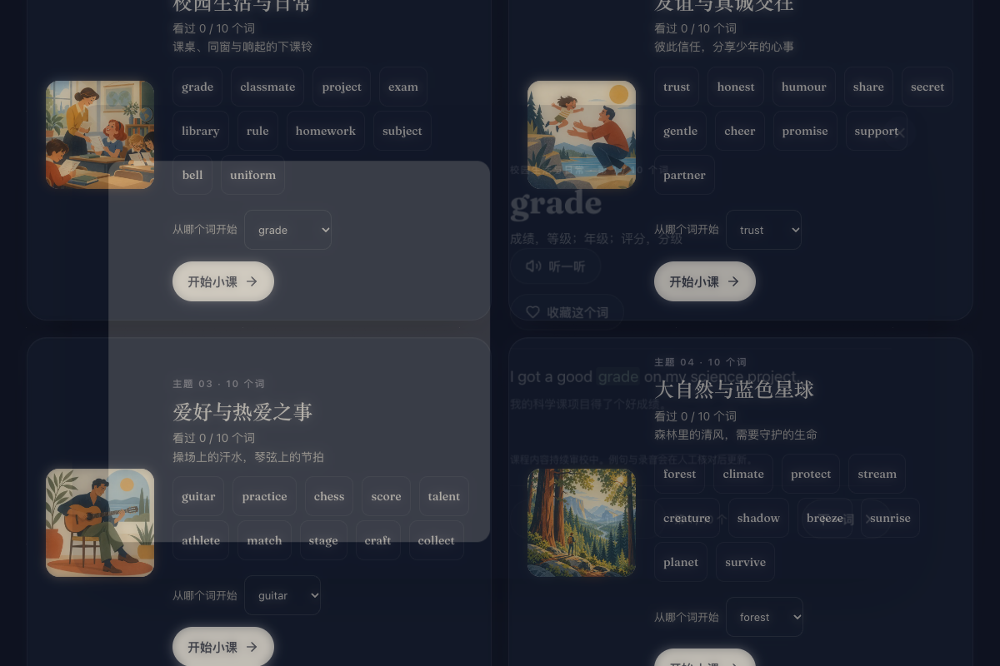

<div align="center">

<a href="https://github.com/gmnoah/word-atlas"></a>

# 词光 · Word Atlas

**把词汇变成画面，让理解与复习有迹可循。**

7,298 雅思词条 · 1,100 初中核心词 · 300 小学起步词 · 300 汉字启蒙  
原创纸感插画 · 英美真人原声 · FSRS 间隔复习 · 3D 知识星图 · 本地优先多档案

[**在线体验 ↗**](https://0xlei.tech/words/)　·　[**48 秒宣传片**](docs/assets/launch.mp4)　·　[**开放词库**](data/)　·　[**English Edition**](README.en.md)

[](https://github.com/gmnoah/word-atlas)
[](LICENSE)
[](CONTENT_LICENSE.md)
[](package.json)
[](tsconfig.json)
[](#本地优先与多档案)

</div>

---

**词光（Word Atlas）** 是一款以**语境插画、纯正发音、主动回忆与科学间隔复习**为核心的现代化全年龄段视觉词汇学习平台。

针对死记硬背容易枯燥放弃的痛点，词光让每个词汇对应一幅复古手绘质感插画与生动例句；配合英美真人语音、语境选义、拼写挑战与现代 FSRS 算法，帮助学习者构建结构清晰的持久记忆网络。**纯前端单页架构，无需注册账号，学习进度与记忆数据完全保存在自己的设备上。**

> **开源说明**：本仓库提供词光的完整开源代码及配套多媒体数据集。在线体验版本独立迭代，功能与仓库可能有所差异；代码与数据集分别遵循 **MIT** 与 **CC BY 4.0** 许可。

[产品预览](#产品预览) · [四大学习空间](#四大学习空间) · [学习机制](#学习机制) · [本地优先与多档案](#本地优先与多档案) · [本地运行与部署](#本地运行与部署) · [开放数据](#开放数据) · [授权与致谢](#授权与致谢)

---

## 产品预览

### 一本可以听、可以练的自然词汇图鉴


<table>
<tr>
<td width="50%"></td>
<td width="50%"></td>
</tr>
<tr><td align="center"><b>每日计划</b>：把专注力留在今天，稳步积累</td><td align="center"><b>词汇卡片</b>：插画、义项、原声音频融为一体</td></tr>
</table>

### 初中英语：全学段 110 单元语境突破

<table>
<tr>
<td width="33%"></td>
<td width="33%"></td>
<td width="33%"></td>
</tr>
<tr>
<td align="center"><b>学段专属卡片</b><br>中学生自学双节奏面板</td>
<td align="center"><b>秒级学段导航</b><br>七/八/九年级 110 单元体系</td>
<td align="center"><b>语境选义单选</b><br>例句划线、搭配与解析反馈</td>
</tr>
</table>

### 学过的词，汇聚成浩瀚的个人星图


词汇按主题化作三维知识星图。支持触控平移、拖动旋转、双指缩放，轻点星宿即可翻开对应词卡；已学与掌握状态以细腻光芒呈现。基于 WebGL2 渲染，不支持 3D 渲染的环境自动提供优雅的主题图谱降级。

<details>
<summary><b>🎬 点击观看 48 秒品牌宣传片</b></summary>

<a href="docs/assets/launch.mp4"></a>

[▶ 播放完整视频（含原创声音）](docs/assets/launch.mp4)

</details>

---

## 四大学习空间

词光打破传统单一词表局限，构建起覆盖全年龄段的立体学习矩阵：

| 学习空间 | 规模与阶段 | 教学重点与核心设计 | 核心交互题型 |
| :--- | :--- | :--- | :--- |
| **🏛 雅思英语**<br>`IELTS Atlas` | **7,298 词**<br>CEFR A1–C2<br>19 个高频分类 | 专为雅思备考与学术进阶设计。每词配备原创插画、双例句（日常短句 + 雅思长句）、英美真人发音与派生搭配。 | 看义选词 · 看图补句<br>听音辨词 · 打字拼写<br>3D 词汇星图 |
| **🎒 初中英语**<br>`Junior High` | **1,100 词**<br>110 个情境单元<br>七/八/九年级 | 依据教育部新课标三级要求构建。涵盖健康竞技、品格逻辑、科学探索、生态文明等 110 个深度主题。定制中学生自学双节奏（5 词/10 词）。 | 语境选义（例句目标词划线）<br>中考高频词块搭配强化<br>上下文线索解析反馈 |
| **🌱 基础英语**<br>`Primary Starter` | **300 词**<br>33 节情境小课<br>小学起步 | 面向小学低龄儿童的英语启蒙。从身边事物、动物与食物出发，低刺激界面与大按钮交互，保护儿童视力与注意力。 | 听音选图 · 看图听词<br>自然拼读辅助 · 亲子跟读 |
| **🀄 汉字启蒙**<br>`Hanzi Starter` | **300 字**<br>32 节主题小课<br>亲子共读 | 面向幼儿家庭亲子共读。在生活情境中感知汉字演变与意象，杜绝机械抄写与死记硬背，不强制拼音或答题测验。 | 图字对应 · 亲子找字<br>情境探索 · 朗读互动 |

---

## 学习机制

学习不是一次性的机械记忆，而是一场由浅入深的探索旅程：


1. **看见（Visual Perception）**：每个词汇均配有同源复古版画插画、规范词性标注、精准中英释义、高频词块搭配与典型例句。
2. **听见（Auditory Linking）**：支持在英国原音（UK）与美国原音（US）间自由切换；每条例句均由真人配音朗读。
3. **想起（Active Recall）**：结合语境单选题、看图补句、听音辨词与拼写挑战，逐步建立抗遗忘的检索提取通道。
4. **科学复习（FSRS 6）**：内置现代先进的 `ts-fsrs`（Free Spaced Repetition Scheduler 6）算法，根据遗忘曲线与首次作答反馈智能计算复习周期。
5. **积累点亮（Progress Tracking）**：学习足迹化作知识星空中的明亮星辰；支持独立打字练习统计与本地学习记录追踪。

<details>
<summary><b>🎵 原声发音与自然环境声试听</b></summary>

以词条 *abandon* 为例（在线试听）：
- 🇬🇧 **英音原声**：[abandon /əˈbændən/](https://0xlei.tech/words/atlas/audio/uk/abandon.mp3)
- 🇺🇸 **美音原声**：[abandon /əˈbændən/](https://0xlei.tech/words/atlas/audio/us/abandon.mp3)
- 📖 **例句朗读**：[We had to abandon our car in the snow.](https://0xlei.tech/words/atlas/audio/ex/abandon.mp3)

### 自然声景与交互音效
| 类型 | 说明与试听 |
| :--- | :--- |
| 🌧 **6 段沉浸式自然环境声** | [雨天图书馆](https://0xlei.tech/words/sfx/amb-rain.mp3) · [清晨海岸](https://0xlei.tech/words/sfx/amb-sea.mp3) · [林间早晨](https://0xlei.tech/words/sfx/amb-forest.mp3) · [夜晚壁炉](https://0xlei.tech/words/sfx/amb-fire.mp3) · [远航船舱](https://0xlei.tech/words/sfx/amb-voyage.mp3) · [安静咖啡馆](https://0xlei.tech/words/sfx/amb-cafe.mp3) |
| 🎵 **星空原声配乐** | [无缝循环星空音乐](https://0xlei.tech/words/sfx/amb-stars.mp3)：沉浸式背词背景音乐，朗读单词时自动压低背景音 |
| ✨ **自然交互声音** | 答对、答错、翻卡、打字敲击、连胜反馈、点亮星星均配有温润轻柔的物理触感音效 |

</details>

---

## 本地优先与多档案

词光坚持**无账号、本地优先（Local-First）、零商业追踪**的产品哲学：

- **零隐私侵扰**：不收集任何个人数据，无广告 SDK，无外部统计代码。
- **家庭多学员档案（Multi-Learner Profiles）**：同一台电脑或平板上可随时切换不同学员档案，雅思、初中、小学、汉字各空间学习记录与断点独立隔离，互不串联。
- **离线即开即用**：基于 Service Worker 实现媒体与静态资源缓存，无网弱网环境下依然能顺畅自习。
- **一键全量备份与无损恢复**：支持随时将包含多学员、各课程进度、断点与偏好设置打包导出为标准 JSON 备份文件，换机时一键无损导入恢复；同时支持单个课程的安全重置与防误触重置保护。

---

## 本地运行与部署

### 环境要求
- **Node.js 20+** 与 **npm**

### 快速启动
```bash
# 1. 克隆本仓库 (由于包含全量插画与录音，首次克隆推荐使用 shallow clone)
git clone --depth 1 https://github.com/gmnoah/word-atlas.git
cd word-atlas

# 2. 安装项目依赖
npm install

# 3. 启动本地开发服务器
npm run dev
```

启动完成后，在浏览器中打开 **`http://localhost:5188`** 即可开始使用。

### 工程与校验脚本
```bash
npm test                # 运行全套单元与集成测试 (260+ 测试用例)
npm run check:atlas     # 雅思 7,298 词库数据结构与媒体文件存在性校验
npm run check:courses   # 校验全量注册多课程 (1,700 词条) 结构契约与规范
npm run build           # 编译 TypeScript 并执行 Vite 生产打包
npm run preview         # 本地预览生产构建产物
```

### 生产部署与静态托管
本项目为纯静态单页架构（SPA），构建后的 `dist/` 目录可直接部署于 GitHub Pages、Vercel、Cloudflare Pages、Netlify 或任何 Nginx / Apache 静态服务器。

若部署在子路径下（例如 `https://your-domain.com/words/`）：
```bash
ATLAS_BASE=/words/ npm run build
```
完整部署配置细节请参阅 [部署文档](docs/deployment.md)。

---

## 开放数据

词光秉承开源开放理念，不仅可直接作为学习工具，亦开放结构化数据集用于学术研究、个人开发或制作 Anki 牌组。

| 资源类别 | 包含内容 | 访问与下载路径 |
| :--- | :--- | :--- |
| **雅思核心词库** | **7,298** 条，CEFR A1–C2 完整评级，19 个高频分类 | [JSON](data/word-atlas.json) · [CSV](data/word-atlas.csv) |
| **双例句库** | **14,596** 条中英对照日常短句与雅思长句 | [字段定义说明](docs/dataset.md) |
| **原创插画库** | **7,298** 幅 512px 高清 WebP 格式情境插画 | [`public/atlas/img/`](public/atlas/img/) |
| **真人录音库** | **22,905** 段英音、美音及例句原声朗读音频 | [`public/atlas/audio/`](public/atlas/audio/) |
| **初中/小学/汉字包** | **1,700** 条多学段课程数据、搭配与语境题型 | [`src/courses/`](src/courses/) |

```python
# 快速读取与筛选数据示例
import json
from pathlib import Path

words = json.loads(Path("data/word-atlas.json").read_text(encoding="utf-8"))
b2_env_words = [w for w in words if w.get("cefr") == "B2" and w.get("topic") == "environment"]
print(f"找到 {len(b2_env_words)} 个 B2 环境类雅思词汇")
```

<details>
<summary><b>查看词条 JSON 数据结构示例</b></summary>

```json
{
  "id": "principle",
  "w": "principle",
  "uk": "/ˈprɪnsəpəl/",
  "us": "/ˈprɪnsəpəl/",
  "senses": [
    {
      "pos": "n.",
      "zh": "原则；行为准则",
      "en": "A belief or rule that guides decisions and behaviour."
    }
  ],
  "ex": [
    {
      "en": "I refused the extra money as a matter of principle.",
      "zh": "出于原则，我拒绝了那笔额外的钱。"
    },
    {
      "en": "The principle of equal opportunity should guide policies designed to improve access to higher education.",
      "zh": "机会均等的原则应当指导旨在扩大学等教育机会的政策制定。"
    }
  ],
  "col": ["in principle｜原则上", "basic principle｜基本原则"],
  "fam": ["principled (adj.)"],
  "tip": "principle 是原则；principal 是校长、主要的。",
  "cefr": "B2",
  "topic": "thinking"
}
```

</details>

> **学术诚实说明**：词库的释义、例句、插画和录音为本项目生成与整理：插画采用生成式工具辅助创作，语音基于高质量语音模型渲染。数据已通过全自动结构契约与多媒体完整性核验；课程扩展包中新研发内容如实标示为 `reviewStatus: "draft"`，严谨区分工程就绪与人工教学审校。本项目非官方雅思及中考委员会出版物，亦不承诺应试提分。

---

## 技术架构

```
┌─────────────────────────────────────────────────────────────┐
│                      词光 · Word Atlas                      │
├───────────────┬───────────────┬──────────────┬──────────────┤
│   雅思英语    │   初中英语    │   基础英语   │   汉字启蒙   │
│  7,298 词库   │   110 单元    │    33 单元   │    32 单元   │
├───────────────┴───────────────┴──────────────┴──────────────┤
│          多课程统一适配器与懒加载中心 (Course Registry)       │
├───────────────────────────────┬─────────────────────────────┤
│   记忆调度算法 (ts-fsrs 6)    │   3D 星图引擎 (WebGL 2.0)   │
├───────────────────────────────┴─────────────────────────────┤
│   家庭多学员档案与隔离协调器 (Learner Context Isolation)    │
├─────────────────────────────────────────────────────────────┤
│   本地优先存储引擎 (LocalStorage / IndexedDB / JSON Backup) │
├─────────────────────────────────────────────────────────────┤
│   自然图鉴美学系统 (Fraunces Serif + 暖象牙纸质 + 沉浸白噪音)│
└─────────────────────────────────────────────────────────────┘
```

- **前端技术栈**：React 19 · TypeScript 5.9 · Vite 6 · ts-fsrs 5.4 · Lucide React · Fraunces Variable
- **性能与交付**：路由懒加载、课程数据按需分包、纯前端静态交付无业务服务器负担。

---

## 参与贡献

欢迎对词条纠错、发音修正、视觉体验或教学功能提出宝贵建议！

- **提交问题**：如发现释义、发音或功能缺陷，请前往 [Issues](https://github.com/gmnoah/word-atlas/issues) 提交反馈，并附上词条 ID、复现步骤或权威词典依据。
- **贡献指南**：请参阅 [CONTRIBUTING.md](CONTRIBUTING.md) 了解代码风格、测试规范与数据校验要求。
- **安全政策**：安全漏洞与敏感问题反馈方式见 [SECURITY.md](SECURITY.md)。

---

## 授权与致谢

| 范围 | 许可协议 | 说明 |
| :--- | :--- | :--- |
| **应用源码** | [MIT License](LICENSE) | 自由修改、分发与二次开发 |
| **词库文本、插画与录音** | [CC BY 4.0](CONTENT_LICENSE.md) | 署名 Word Atlas contributors（词光）即可自由分享与创作 |
| **内置字体与第三方库** | 遵循各自开源许可 | 见项目许可文件与对应依赖说明 |

---

由 [@gmnoah](https://github.com/gmnoah) 维护与开发。原开源雅思版由 [@designfuchen](https://github.com/designfuchen) 创制。  
如果词光在你的求知与复习旅程中带来了一缕启发，欢迎点击右上角 **Star ⭐️** 收藏支持！
